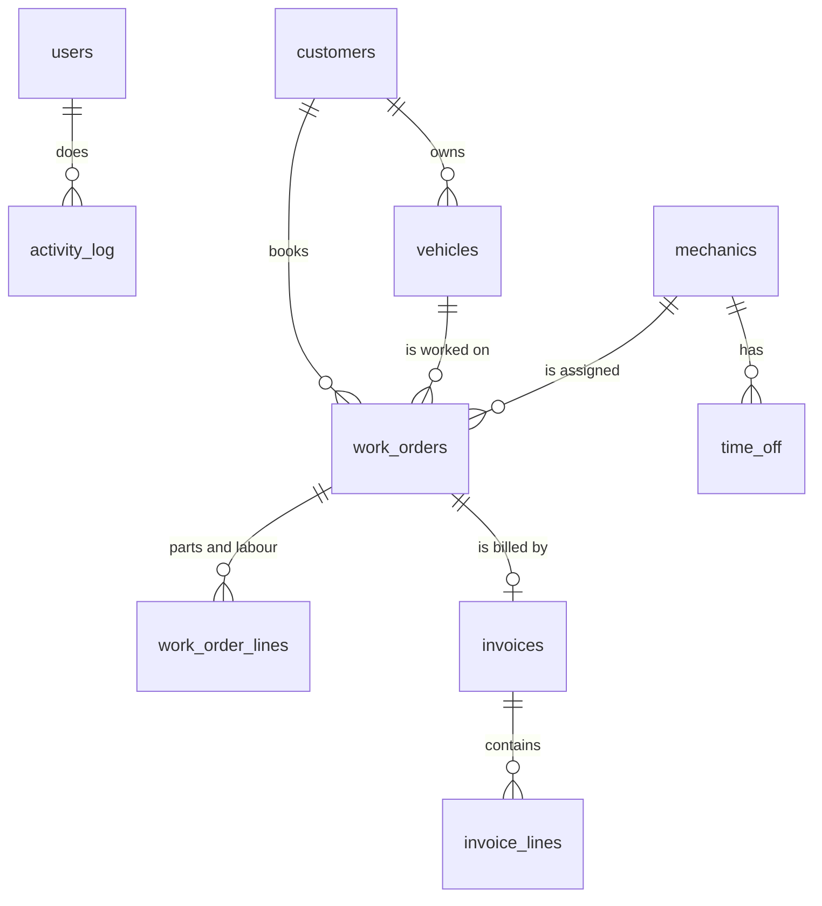

# Data model

MySQL 8 / MariaDB, `utf8mb4`. Money is stored in **cents** (integer). Dates are workshop-local dates (`Europe/Vilnius`); timestamps are UTC.

## Tables

### users
Laravel default. One account (the owner) in v1. Registration is disabled.

### mechanics
| column | type | notes |
|---|---|---|
| id | bigint | |
| name | string | |
| vehicle_types | json | any of `car`, `moto`, `water` |
| work_days | json | ISO weekdays 1–6, e.g. `[1,2,3,4,5]` |
| color | string null | optional accent in the calendar |
| sort_order | int | row order in the calendar |
| active | bool | inactive mechanics are hidden from new bookings, history stays |

### time_off
| column | type | notes |
|---|---|---|
| mechanic_id | fk | |
| type | enum | `holiday`, `day_off`, `sick` |
| starts_on, ends_on | date | inclusive |
| note | string null | |

### closures
Workshop closed days for everyone (public holidays).

| column | type | notes |
|---|---|---|
| date | date unique | |
| name | string | e.g. "Kalėdos" |

### customers
| column | type | notes |
|---|---|---|
| name | string | person or company name |
| phone | string | searchable |
| email | string null | |
| company_code, vat_code, address | string null | for invoices to companies |
| notes | text null | |

### vehicles
| column | type | notes |
|---|---|---|
| customer_id | fk | |
| type | enum | `car`, `moto`, `water` |
| make_model | string | "VW Passat" |
| year | smallint null | |
| plate | string null | searchable, stored upper-case without spaces, shown formatted |
| vin | string null | |

### work_orders (shown as "jobs" in the UI)
Laravel already uses a `jobs` table for its queue, so the code calls a job a **work order** (`WorkOrder` model).

| column | type | notes |
|---|---|---|
| number | int unique | shown as 0001 on job cards |
| customer_id, vehicle_id, mechanic_id | fk | |
| description | text | work to be done |
| start_date | date | |
| start_quarter | tinyint | 0-based |
| duration_quarters | smallint | ≥ 1 |
| planned_quarters | smallint | duration when first booked |
| status | enum | `scheduled`, `in_progress`, `waiting_parts`, `completed` |
| notify_customer | enum null | `earlier`, `later` |
| mileage | int null | at intake, printed on the job card |
| completed_at | timestamp null | |

End position is **computed**, not stored (it depends on closures). Index: `(mechanic_id, start_date)`.

### work_order_lines
Labour and parts noted on the job, copied into the invoice.

| column | type | notes |
|---|---|---|
| work_order_id | fk | |
| kind | enum | `labour`, `part` |
| description | string | |
| quantity | decimal(10,2) | |
| unit | string | `h`, `pcs`, `l` |
| unit_price_cents | int | without VAT |

### invoices
Frozen copy at the time of issue. Editing the job afterwards does not change an issued invoice.

| column | type | notes |
|---|---|---|
| work_order_id | fk unique | one invoice per job in v1 |
| series, number | string, int | unique together; `MAE` + 1 → `MAE-0001` |
| issued_on, due_on | date | |
| seller | json | company details at issue time |
| buyer | json | customer details at issue time |
| vat_payer | bool | decides the title "PVM sąskaita faktūra" vs "Sąskaita faktūra" |
| vat_rate | decimal(5,2) | |
| subtotal_cents, vat_cents, total_cents | int | |
| voided_at | timestamp null | void instead of delete |

### invoice_lines
Same columns as `work_order_lines` plus `line_total_cents`.

### settings
Key-value (`key` string unique, `value` json). Keys:
`locale` (`lt`/`en`), `company` (name, code, vat_code, address, bank, phone, email, logo path),
`vat_payer`, `vat_rate`, `invoice_series`, `invoice_next_number`, `hourly_rate_cents`, `payment_days`,
`hours` (per weekday: open, close, quarters).

### activity_log
| column | type | notes |
|---|---|---|
| user_id | fk null | |
| subject_type, subject_id | morph | job, invoice, mechanic… |
| action | string | `job.moved`, `job.extended`, `job.status`, `job.informed`, `invoice.issued`… |
| changes | json | before/after |
| created_at | timestamp | |

## Invoice numbering

Taken inside a DB transaction with a row lock on the `invoice_next_number` setting, so two quick clicks
cannot produce the same number. Numbers are never reused, including after a void.
