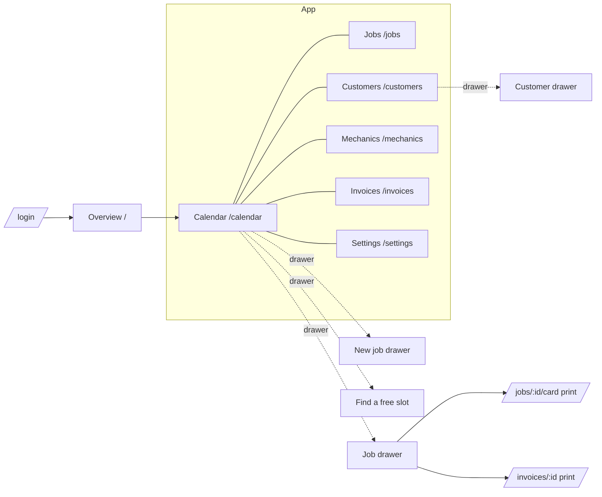

# Sitemap

All pages need login except `/login`. Inertia pages live in `resources/js/pages`.

| URL | Page | Main actions |
|---|---|---|
| `/login` | Login | email + password, remember me |
| `/` | Overview | KPI cards, workload chart, mechanics' load, upcoming jobs |
| `/calendar` | Calendar | month / week / day; click empty spot → new job; click job → job drawer; side lists "Customers to contact" and "Could move earlier"; free capacity row |
| `/jobs` | Jobs list | filter by status and "to contact"; search; opens job drawer |
| `/jobs/{job}/card` | Job card | A4 print layout |
| `/customers` | Customers | search name/phone/plate; customer drawer with vehicles and job history; new job for this customer |
| `/mechanics` | Mechanics | list, add/edit, working days, vehicle types; holidays and days off; workshop closed days |
| `/invoices` | Invoices | list, filter by month; open, print, void |
| `/invoices/{invoice}` | Invoice | A4 print layout |
| `/jobs/{job}/invoice/create` | Issue invoice | edit lines, preview, issue |
| `/settings` | Settings | language, company details, invoice settings, working hours, change password |
| `/manifest.webmanifest`, `/sw.js` | PWA | install to home screen |

Drawers are part of the calendar, jobs and customers pages (not separate URLs), but the open job is kept in the
query string (`?job=123`) so a link or a page refresh reopens it.

## JSON endpoints used by drawers

| Method + URL | Purpose |
|---|---|
| `GET /api/slots?duration=4&type=car` | find a free slot, per mechanic |
| `GET /api/customers/search?q=` | customer autocomplete |
| `POST /jobs` | create |
| `PATCH /jobs/{job}` | edit fields |
| `POST /jobs/{job}/move` | mechanic, date, quarter |
| `POST /jobs/{job}/duration` | delta or exact quarters |
| `POST /jobs/{job}/status` | status change, "completed now" |
| `POST /jobs/{job}/informed` | clear "customer to contact" |

These are normal Laravel routes with session auth (Inertia partial reloads where possible), not a separate API.
